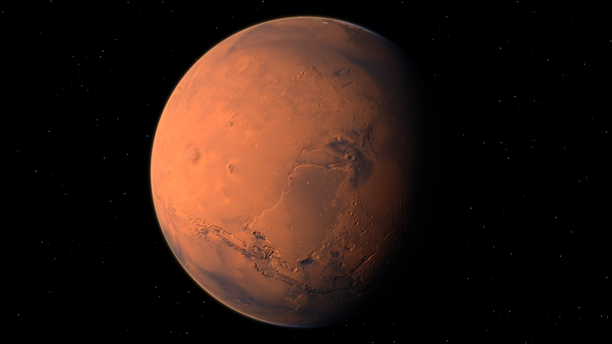
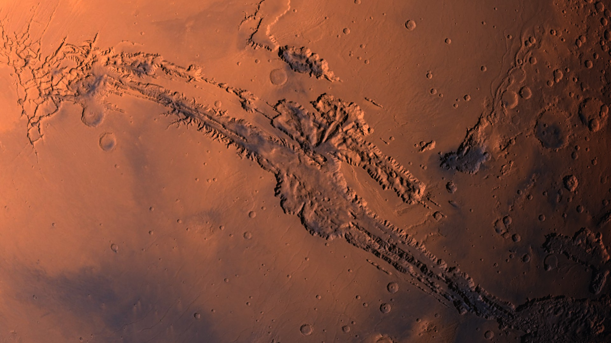
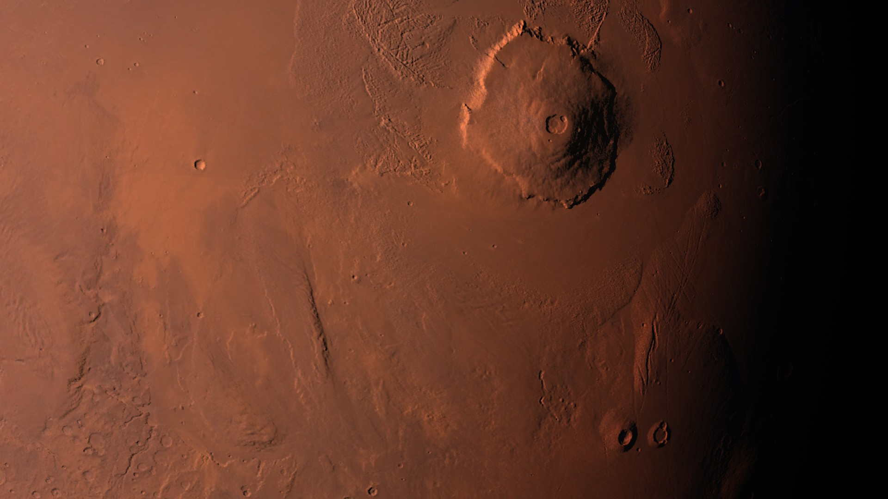

# Rotating Mars

A live wallpaper showing Mars rotating in real time, rendered in the browser with WebGL2.

| Valles Marineris | Olympus Mons at dusk |
|---|---|
|  |  |

The close-ups are the same wallpaper with a higher `zoom`; the animation is sped up
(the default is one rotation every 10 minutes).

- Terrain relief from laser altimetry, lit by the sun and changing as the planet turns
- Day/night terminator with a reddened twilight
- Dust haze and a thin atmosphere glow at the limb
- Star field
- Works on any screen size; everything is adjustable

## Use

**Lively Wallpaper** (Windows, free): download `rotating-mars-1.0.zip` from the
[latest release](https://github.com/fgourdeau/rotating-mars-wallpaper/releases/latest)
and drag it onto the Lively window.
Right-click the tile, then *Customise*, to adjust the settings.

**Any browser**: open `index.html`. Settings can be passed in the address, for example
`index.html?period=2&zoom=1&tilt=30`.

| Setting | Meaning | Default |
|---|---|---|
| `period` | Minutes per full rotation | 10 |
| `zoom` | Globe radius as a fraction of the screen height | 0.45 |
| `offsetX`, `offsetY` | Globe position, % of screen height | 0 |
| `sunAz`, `sunEl` | Sun direction, degrees (left/right, down/up) | -55, 12 |
| `relief` | Terrain exaggeration (1 = true to scale) | 3 |
| `atmosphere`, `stars` | Strength of each effect (0 = off) | 1 |
| `distance` | Camera distance in Mars radii (large = flatter) | 3 |
| `tilt` | North pole towards (+) or away from (-) the viewer, degrees | 20 |
| `roll` | Rotation axis leaning left (-) or right (+), degrees | 18 |
| `fps` | Frames per second | 30 |

## How it works

There is no 3D mesh. For every pixel, a ray is cast from the camera and intersected with a
perfect sphere; the hit point gives a latitude and longitude, which are looked up in two maps:

- `texture.js`: surface colour, 8192 x 4096
- `relief.js`: east and north terrain slopes, 8192 x 4096, used to tip the surface normal

Both maps are JPEG images embedded as base64 so the page also works when opened from disk.
The relief is slope shading, not cast shadows.

## Requirements

A GPU and browser with WebGL2. The two maps use roughly 350 MB of video memory.

## Data credits

- Colour: Viking Orbiter global colour mosaic (MDIM 2.1), NASA / JPL / USGS Astrogeology Science Center
- Relief: Mars Global Surveyor MOLA gridded topography (MEGDR, 32 pixels per degree), NASA / GSFC, MOLA Science Team

Both datasets are in the public domain.

## License

Code: MIT, see LICENSE. Copyright (c) 2026 François Gourdeau.
The embedded maps are derived from the public-domain datasets credited above.
